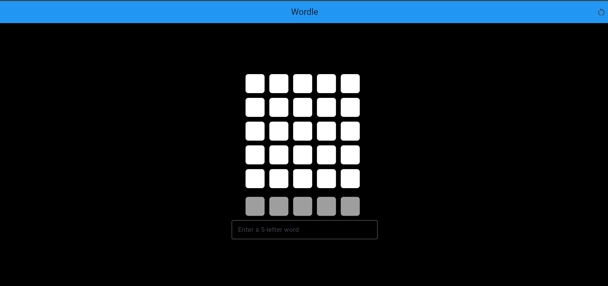
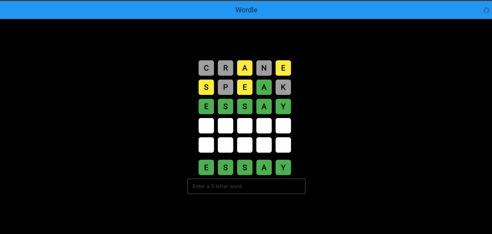

# Wordle Frontend

A Flutter implementation of the Wordle word-guessing game. This directory contains the app UI, game logic, and word lists; it is the frontend portion of the larger repository.

## Implemented features

- Start a game with a randomly selected five-letter answer.
- Enter guesses using the text field; guesses are checked against the bundled word lists.
- View letter feedback: green for the correct letter and position, yellow for a letter in another position, and gray for a letter not in the answer.
- Play up to five guesses. The answer is shown when the game ends.
- Restart with a new answer using the app-bar restart button.

## Tech stack

- Flutter and Dart
- Provider for game state
- Flutter Test for automated tests

## Prerequisites and run

Install Flutter with Dart **3.13.0 or later**, and have a supported target available (for example, Chrome for web). From this directory:

```sh
flutter pub get
flutter run -d chrome
```

`flutter run -d chrome` uses the Chrome web target. To run on another supported target, replace `chrome` with its device ID from `flutter devices`. The commands above are the standard Flutter workflow; target availability depends on the local Flutter and platform setup.

## Tests

Run the test suite from this directory:

```sh
flutter test
```

Tests cover word feedback and letter access, seeded answer selection, game guess limits and reset behavior, and word-list selection/data checks.

## Screenshots

### Game start



### Game end



## Future improvements

- Provide clear feedback when a submitted guess is invalid or has the wrong length.
- Add an on-screen keyboard and accessibility refinements.
- Consider daily puzzles and persistent game statistics.
